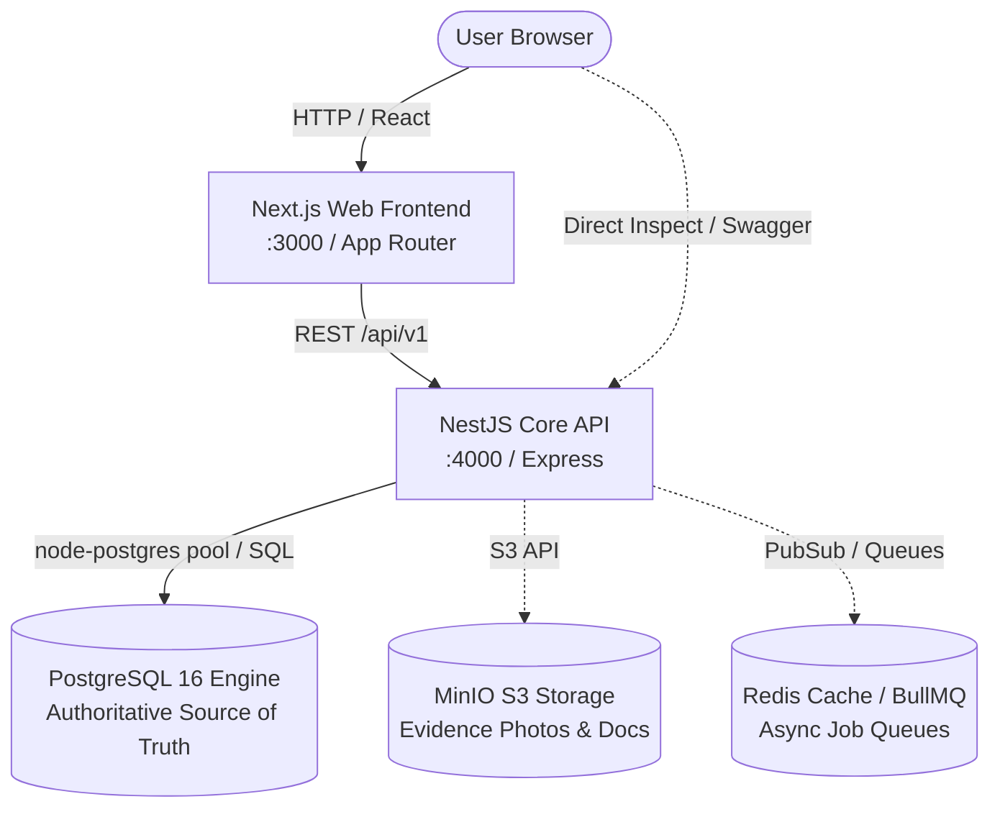

# Architecture & System Design

## 1. Overview
The platform is designed as an authoritative database-first modular monolith supporting the rental lifecycle of high-value physical assets between untrusted parties.

## 2. Layered Architecture Flow
1. **Next.js Web Frontend (`apps/web`)**:
   - Built on Next.js App Router, React 19, and Tailwind CSS.
   - Responsible for rendering interfaces, status dashboards, booking funnels, and evidence upload workflows.
   - Consumes backend services purely via standard HTTP REST APIs against `/api/v1`.
2. **NestJS Modular Core API (`apps/api`)**:
   - Enforces authentication (`DevAuthGuard` in Phase 1, JWT in Phase 5), RBAC role policies (`@Roles`), validation pipes, and request-id tracing.
   - Provides OpenAPI/Swagger documentation at `/api/docs`.
   - Delegates business transaction integrity and data consistency to PostgreSQL.
3. **PostgreSQL 16 Database Engine (`db/`)**:
   - **Authoritative Source of Truth**: The database enforces business rules, state transitions, exclusion locks, check constraints, immutable ledger transactions, and audit logging at the engine level. No business layer or API bug can violate underlying state machine invariants.
4. **Storage & Worker Subsystems (Optional / Future Phases)**:
   - **MinIO**: S3-compatible object storage for tamper-evident condition inspection photographs.
   - **Redis**: Rate limiting, caching, and background job queue processing.

## 3. Why a Modular Monolith?
- **Single Source of Truth**: Eliminates multi-database distributed transactions, two-phase commits, and data desynchronization.
- **Operational Simplicity**: Single repo, cohesive migrations, rapid test feedback (`npm run db:test` in milliseconds), and unified container deployment.
- **Strict Domain Boundaries**: Modules are organized logically (Auth, Bookings, Assets, Handover, Returns, Disputes, Ledger, Audit) with clean interfaces and dependency isolation.

## 4. Rule: PostgreSQL is Authoritative
Application code in NestJS acts as an orchestration and presentation layer. It does not replace or duplicate database-level constraints:
- Double-booking prevention is enforced via PostgreSQL GiST temporal exclusion constraints (`tsrange`).
- Finite-state transitions (e.g. Asset Lifecycle, Booking Status) are validated through explicit SQL trigger functions (`enforce_allowed_transitions`).
- Ledger double-entry balance (Debits = Credits) is checked at `COMMIT` time through deferrable triggers.
- Immutable event logs (`audit_logs`, `booking_events`, `ledger_entries`) reject all `UPDATE` and `DELETE` operations via database trigger rules.

## 5. Domain Module Directory
- **Auth**: User registration, session/token management.
- **Users**: User profiles, verification state, contact credentials.
- **Assets**: Physical equipment items, serials, owner links, condition ratings.
- **Categories**: Equipment categorization hierarchy and rental rules.
- **Listings**: Rental pricing tiers, deposit specifications, availability windows.
- **Bookings**: Reservation requests, rental agreements, GiST exclusion range locks.
- **Inspections**: Check-in and check-out evidence capture, condition grading, SHA-256 evidence hashing.
- **Handover**: Custody transfer verification, dual-party signatures/confirmations.
- **Returns**: Asset check-in, delta condition assessment.
- **Maintenance**: Repair records, service downtime locks, operational re-certification.
- **Disputes**: Conflict resolution, damage claims, security deposit escrow arbitration.
- **Trust & Health**: Composite trust scores for parties and degradation scores for equipment.
- **Payments & Ledger**: Double-entry ledger journal, authorizations, captures, deposit releases.
- **Audit**: Append-only compliance log capturing actors, actions, and forensic payloads.
- **Admin-DB**: Health monitoring, migration diagnostics, and system stats.
