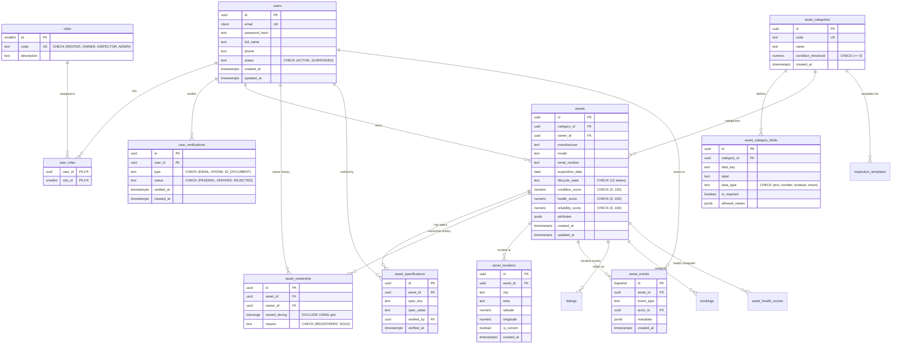
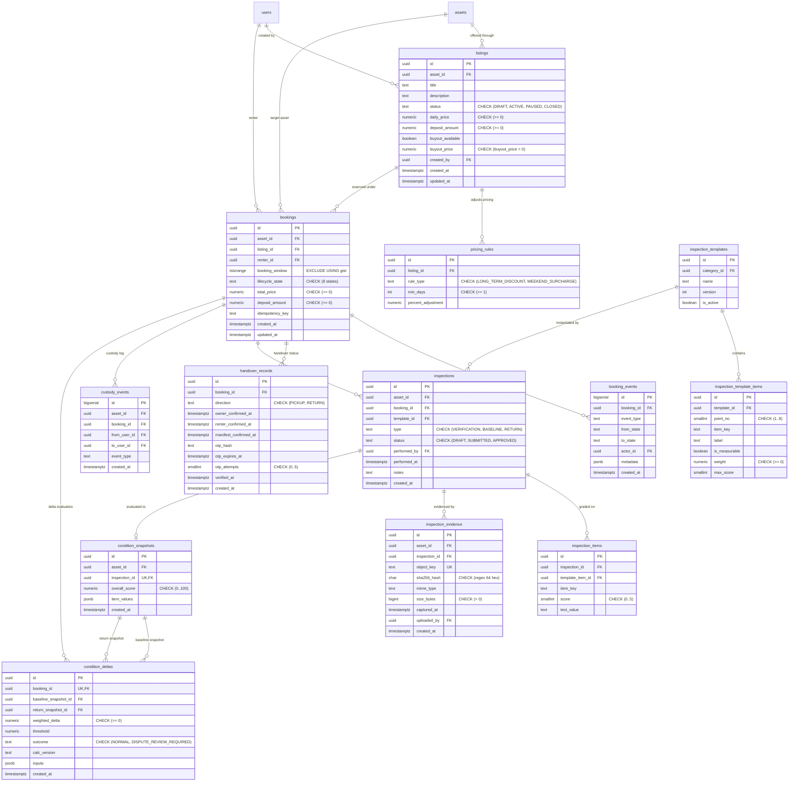

# Entity-Relationship Diagrams: {{APP_NAME}}

The database schema is organized into three clean functional sub-domains to maintain clarity and scannability:
1. **Identity, Assets, and Ownership**
2. **Bookings, Inspections, and Custody**
3. **Ledger, Disputes, Trust Scores, and Audit**

---

## 1. Domain: Identity, Assets, and Ownership

---

## 2. Domain: Bookings, Inspections, and Custody

---

## 3. Domain: Ledger, Disputes, Trust Scores, and Audit

```mermaid
erDiagram
    users ||--o{ ledger_accounts : "holds account"
    bookings ||--o{ ledger_transactions : "linked to"
    ledger_transactions ||--o{ ledger_entries : "balanced lines"
    ledger_accounts ||--o{ ledger_entries : "debited/credited"

    bookings ||--o{ disputes : "contested via"
    users ||--o{ disputes : "opened by"
    users ||--o{ disputes : "resolved by"
    disputes ||--o{ dispute_events : "history logs"

    bookings ||--o{ reviews : "reviewed for"
    users ||--o{ reviews : "reviewer"
    users ||--o{ reviews : "reviewee"

    users ||--o{ trust_scores : "scored"
    users ||--o{ notifications : "notified"
    users ||--o{ audit_logs : "actor"

    ledger_accounts {
        uuid id PK
        text code UK
        text type "CHECK (USER_DEPOSIT, ESCROW, PLATFORM_REVENUE, OWNER_PAYABLE, EXTERNAL)"
        uuid owner_user_id FK
        timestamptz created_at
    }

    ledger_transactions {
        uuid id PK
        uuid booking_id FK
        text kind "CHECK (DEPOSIT_HELD, DEPOSIT_RELEASED, ...)"
        text idempotency_key UK
        text description
        timestamptz created_at
    }

    ledger_entries {
        bigserial id PK
        uuid transaction_id FK
        uuid account_id FK
        text direction "CHECK (DEBIT, CREDIT)"
        numeric amount "CHECK (> 0)"
        timestamptz created_at
    }

    disputes {
        uuid id PK
        uuid booking_id FK
        uuid opened_by FK
        text reason
        text status "CHECK (OPEN, UNDER_REVIEW, RESOLVED)"
        text resolution "CHECK (RENTER_FAULT, OWNER_FAULT, SPLIT, NO_FAULT)"
        uuid resolved_by FK
        timestamptz opened_at
        timestamptz resolved_at
    }

    dispute_events {
        bigserial id PK
        uuid dispute_id FK
        text event_type
        uuid actor_id FK
        text notes
        uuid evidence_id FK
        timestamptz created_at
    }

    maintenance_records {
        uuid id PK
        uuid asset_id FK
        text type "CHECK (ROUTINE, INSPECTION_DRIVEN)"
        text description
        date performed_on
        date next_due_on
        numeric cost "CHECK (>= 0)"
        uuid verified_by FK
        timestamptz created_at
    }

    repair_records {
        uuid id PK
        uuid asset_id FK
        uuid damage_report_id FK
        text description
        numeric cost "CHECK (>= 0)"
        date started_on
        date completed_on
    }

    damage_reports {
        uuid id PK
        uuid asset_id FK
        uuid booking_id FK
        uuid reported_by FK
        text description
        smallint severity "CHECK (1..5)"
        timestamptz created_at
    }

    trust_scores {
        uuid id PK
        uuid user_id FK
        text kind "CHECK (OWNER, RENTER)"
        numeric score "CHECK (0..100)"
        jsonb factors
        text calc_version
        timestamptz computed_at
    }

    asset_health_scores {
        uuid id PK
        uuid asset_id FK
        numeric score "CHECK (0..100)"
        jsonb inputs
        text calc_version
        timestamptz computed_at
    }

    reviews {
        uuid id PK
        uuid booking_id FK
        uuid reviewer_id FK
        uuid reviewee_id FK
        smallint rating "CHECK (1..5)"
        text comment
    }

    notifications {
        uuid id PK
        uuid user_id FK
        text type
        jsonb payload
        timestamptz read_at
        timestamptz created_at
    }

    audit_logs {
        bigserial id PK
        uuid actor_id
        text action
        text entity_type
        text entity_id
        text request_id
        jsonb before_state
        jsonb after_state
        jsonb metadata
        timestamptz created_at
    }

    outbox_events {
        bigserial id PK
        text aggregate_type
        text aggregate_id
        text event_type
        jsonb payload
        timestamptz created_at
        timestamptz processed_at
        int attempts
    }

    idempotency_keys {
        uuid id PK
        uuid user_id FK
        text key
        text endpoint
        text request_hash
        int response_status
        jsonb response_body
        timestamptz created_at
    }
```

