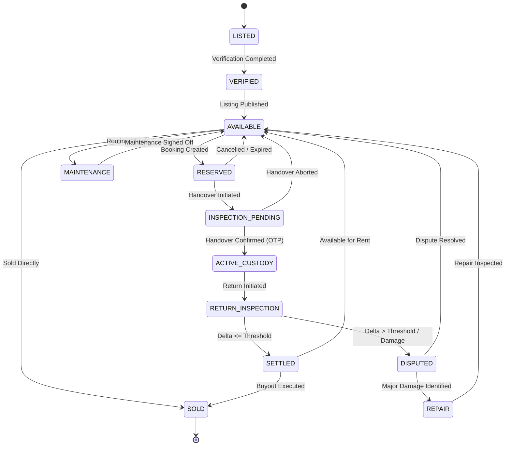
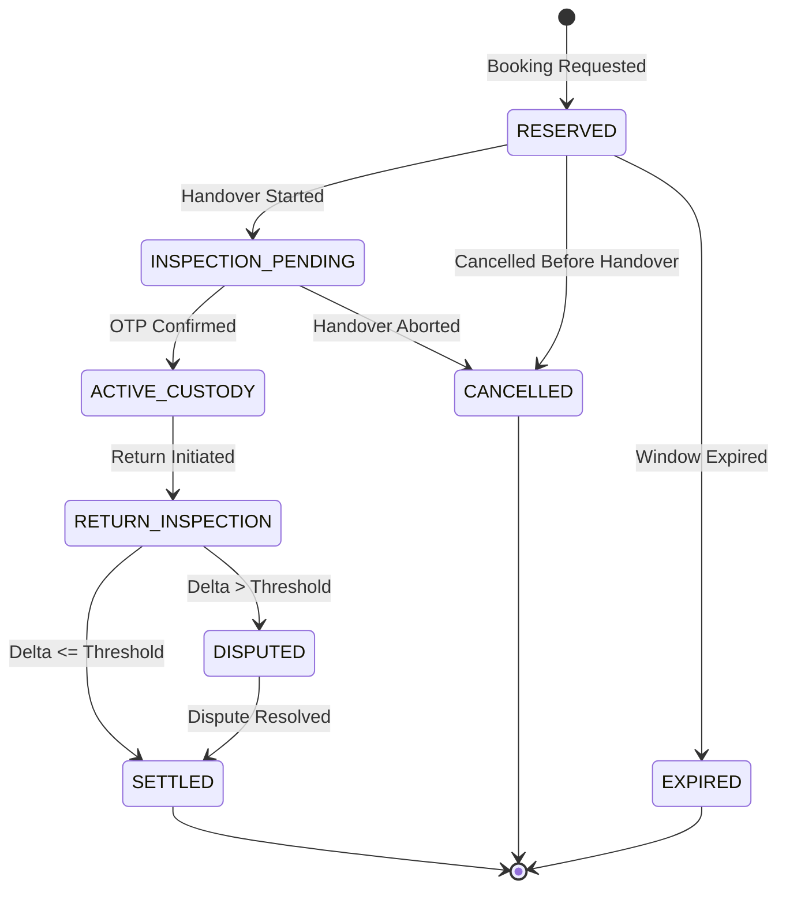
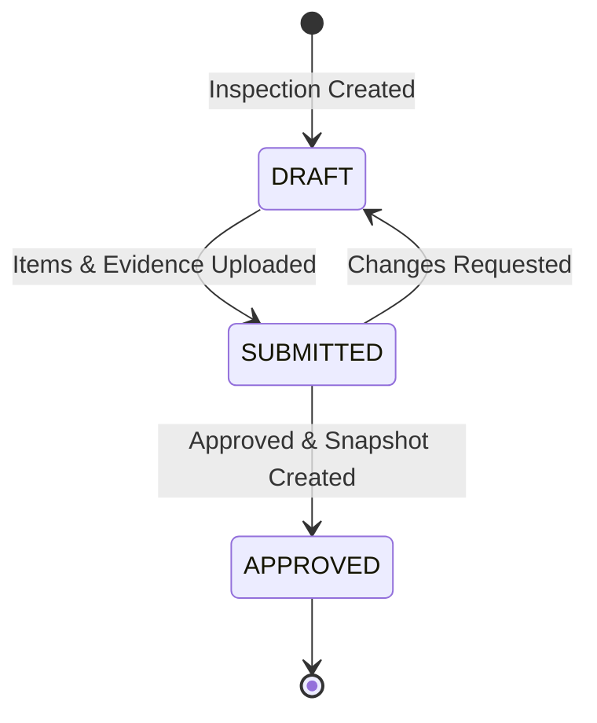
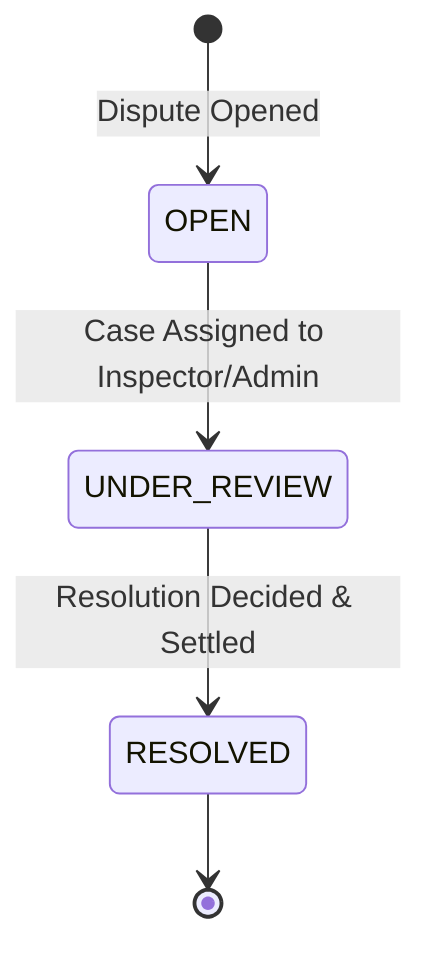
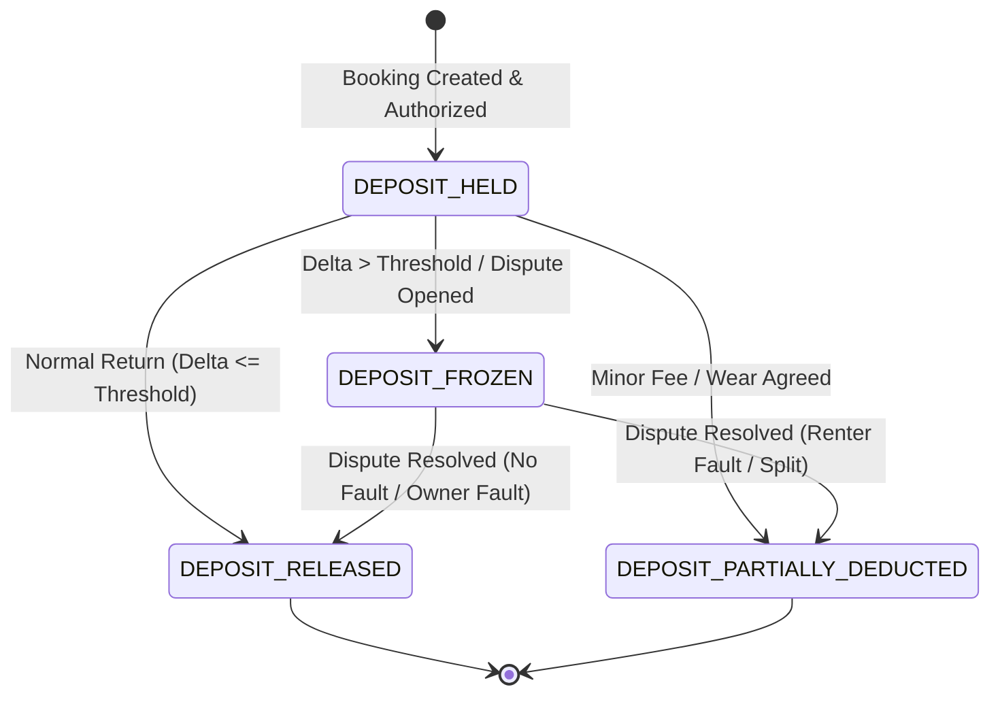

# State Machines Specification: {{APP_NAME}}

This document specifies the authoritative state transitions, transition tables, triggers, and Mermaid state diagrams for all core entities in {{APP_NAME}}.

---

## 1. Asset Lifecycle State Machine

The complete lifecycle of physical assets:
`LISTED`, `VERIFIED`, `AVAILABLE`, `RESERVED`, `INSPECTION_PENDING`, `ACTIVE_CUSTODY`, `RETURN_INSPECTION`, `SETTLED`, `DISPUTED`, `MAINTENANCE`, `REPAIR`, `SOLD`.

### Transitions Table

| From State | To State | Trigger / Event | Preconditions |
| :--- | :--- | :--- | :--- |
| `LISTED` | `VERIFIED` | Owner passes initial verification | Verification evidence and specs recorded |
| `VERIFIED` | `AVAILABLE` | Listing published for rent | Category fields valid & pricing set |
| `AVAILABLE` | `RESERVED` | Booking requested & deposit held | No overlapping reservation window |
| `AVAILABLE` | `MAINTENANCE` | Scheduled routine maintenance | Asset taken offline by owner |
| `AVAILABLE` | `SOLD` | Direct purchase / buyout completed | Buyout terms satisfied & settled |
| `RESERVED` | `INSPECTION_PENDING` | Pre-rental handover window opened | Renter ready for baseline inspection |
| `RESERVED` | `AVAILABLE` | Booking cancelled or expired | Escrow/deposit released |
| `INSPECTION_PENDING`| `ACTIVE_CUSTODY` | Mutual handover OTP verified | Baseline 8-point inspection approved |
| `INSPECTION_PENDING`| `AVAILABLE` | Handover aborted / inspection failed | Handover rejected or expired |
| `ACTIVE_CUSTODY` | `RETURN_INSPECTION` | Return initiated | Renter initiates return process |
| `RETURN_INSPECTION` | `SETTLED` | Return inspection approved, Delta <= Threshold | Condition within normal delta limit |
| `RETURN_INSPECTION` | `DISPUTED` | Delta > Threshold or damage reported | Evidence review / dispute opened |
| `SETTLED` | `AVAILABLE` | Post-return release | Asset clean & ready for next booking |
| `SETTLED` | `SOLD` | Post-rental buyout completed | Buyout transaction confirmed |
| `DISPUTED` | `REPAIR` | Dispute resolved requiring repair | Repair liability attributed |
| `DISPUTED` | `AVAILABLE` | Dispute resolved without major damage | Minor claim settled via deposit |
| `MAINTENANCE` | `AVAILABLE` | Maintenance completed | Service record signed off |
| `REPAIR` | `AVAILABLE` | Repair completed and inspected | Functional test passed |

### State Diagram

---

## 2. Booking Lifecycle State Machine

States: `RESERVED`, `INSPECTION_PENDING`, `ACTIVE_CUSTODY`, `RETURN_INSPECTION`, `SETTLED`, `DISPUTED`, `CANCELLED`, `EXPIRED`.

### Transitions Table

| From State | To State | Trigger / Event | Preconditions |
| :--- | :--- | :--- | :--- |
| `RESERVED` | `INSPECTION_PENDING` | Baseline inspection started | Deposit authorized / held |
| `RESERVED` | `CANCELLED` | Cancelled by renter or owner | Prior to handover window |
| `RESERVED` | `EXPIRED` | Timeout without handover initiation | Handover cutoff exceeded |
| `INSPECTION_PENDING`| `ACTIVE_CUSTODY` | Mutual handover OTP confirmed | Baseline inspection approved |
| `INSPECTION_PENDING`| `CANCELLED` | Mutual handover cancelled | Failed baseline inspection |
| `ACTIVE_CUSTODY` | `RETURN_INSPECTION` | Return handover initiated | Renter delivers asset |
| `RETURN_INSPECTION` | `SETTLED` | Return inspection passed, Delta <= Threshold | Deposit release authorized |
| `RETURN_INSPECTION` | `DISPUTED` | Return inspection reveals anomaly, Delta > Threshold | Dispute case created |
| `DISPUTED` | `SETTLED` | Dispute resolved by inspector/admin | Split or settlement applied |
| `SETTLED` | [*] | Booking archived | Financial ledger reconciled |
| `CANCELLED` | [*] | Booking closed | Any held funds released |
| `EXPIRED` | [*] | Booking closed | No financial lock remains |

### State Diagram

---

## 3. Inspection State Machine

States: `DRAFT`, `SUBMITTED`, `APPROVED`.

### Transitions Table

| From State | To State | Trigger / Event | Preconditions |
| :--- | :--- | :--- | :--- |
| `DRAFT` | `SUBMITTED` | Inspector/user submits checklist items | All 8 manifest items scored |
| `SUBMITTED` | `APPROVED` | Final inspection verification accepted | Evidence photographic hashes verified |
| `SUBMITTED` | `DRAFT` | Inspector requests checklist revisions | Missing photographs or metrics |

### State Diagram

---

## 4. Dispute State Machine

States: `OPEN`, `UNDER_REVIEW`, `RESOLVED`.

### Transitions Table

| From State | To State | Trigger / Event | Preconditions |
| :--- | :--- | :--- | :--- |
| `OPEN` | `UNDER_REVIEW` | Inspector or Admin assigns case | Supporting dispute events appended |
| `UNDER_REVIEW` | `RESOLVED` | Admin issues binding resolution | `resolution` set to `RENTER_FAULT`, `OWNER_FAULT`, `SPLIT`, or `NO_FAULT` |

### State Diagram

---

## 5. Deposit Ledger Lifecycle

States: `DEPOSIT_HELD`, `DEPOSIT_RELEASED`, `DEPOSIT_PARTIALLY_DEDUCTED`, `DEPOSIT_FROZEN`.

### Transitions Table

| From State | To State | Trigger / Event | Preconditions |
| :--- | :--- | :--- | :--- |
| `DEPOSIT_HELD` | `DEPOSIT_RELEASED` | Normal settlement completed | Return Delta <= Category Threshold |
| `DEPOSIT_HELD` | `DEPOSIT_PARTIALLY_DEDUCTED` | Minor agreed repair or late fee | Deduct partial amount; remainder released |
| `DEPOSIT_HELD` | `DEPOSIT_FROZEN` | Dispute opened upon return | Condition Delta > Threshold |
| `DEPOSIT_FROZEN` | `DEPOSIT_RELEASED` | Dispute resolved: NO_FAULT or OWNER_FAULT | Full refund returned to renter |
| `DEPOSIT_FROZEN` | `DEPOSIT_PARTIALLY_DEDUCTED` | Dispute resolved: RENTER_FAULT or SPLIT | Assessed damages paid to owner |

### State Diagram

